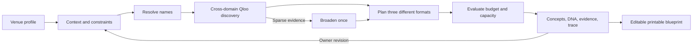

# Third Place Lab

**Turning little spaces into places that feel like home.**

A cultural event-planning partner for independent cafés, bookshops, and community spaces. Describe your space and the things your people love; leave with three distinctive gatherings, visible evidence, practical constraints, and an editable event blueprint.

Public source: [mridul12-cat/Third-Place-Lab](https://github.com/mridul12-cat/Third-Place-Lab).

Built for the Qloo Agentic Hackathon 2026. Local demo mode needs no API account or database. All application live research requires the official Qloo credential, explicit activation, and a shared request-budget database. The active local target is native Next.js on Vercel Hobby with Turso Free; account eligibility and remote operation remain unverified.

## What works

- Guided three-step venue studio with two editable fictional examples and a browser-saved draft.
- Observable, bounded planning loop: context → entity resolution → cultural tools → observation → candidate planning → feasibility evaluation → refinement → blueprint.
- Three structurally different formats: conversation, listening, and making.
- Interactive Cultural DNA cards and Why this works panels with explicit provenance.
- Material revisions for cost, intimacy, group size, family participation, cultural direction, and surprise.
- A generic rules-based baseline comparison (not an LLM comparison).
- Editable itemized budget and invitation copy; clipboard export, JSON download, and print-friendly blueprint.
- Mobile layouts, keyboard controls, visible focus, reduced motion, validation, streaming progress, and explicit errors.

## Why Qloo matters

Qloo resolves cultural names into entities and returns cross-domain references using those entities as signals. The planner translates returned references into conversation, listening, and making prompts. IDs, queried input signals, and available affinity/explainability remain attributable. Templates alone cannot supply these cross-domain API references.

**The default build uses handcrafted synthetic connections, visibly labeled Demo mode / Sample data. It does not contain genuine Qloo findings. The live adapter was verified locally on October 23, 2026 for two artist-input scenarios and one budget refinement, in addition to HTTP fixture tests. Production has not been switched to live mode. See the dated audit for the bounded verified scope.**

## Stack and architecture

React 19, strict TypeScript, Zod, Lucide, Vitest, Playwright, and App Router-compatible route handlers. Native Next.js builds the App Router application for the Node.js runtime. The original Sites/Vinext Worker path remains available through explicit rollback scripts; the existing hosted application has not been changed. Styling uses CSS with the starter Tailwind pipeline. No hosted LLM is called; creative planning uses deterministic evidence-aware templates.



See [architecture](docs/architecture.md), [agent workflow](docs/agent-workflow.md), [decisions](docs/decisions.md), and [Qloo integration](docs/qloo-integration.md).

## Local setup

Node.js 22.13+ and npm are required. Node 25 was used during development.

```sh
npm ci
cp -n .env.example .env.local # fresh clone only; preserve any existing local key
QLOO_MODE=mock npm run dev
```

The default local URL is http://localhost:3000. Set `APP_ORIGIN` to the exact browser origin if using another hostname/port. Production requires this setting; HTTP loopback is permitted for local production tests. Keep existing local credentials private and do not overwrite `.env.local`.

| Variable | Default | Purpose |
| --- | --- | --- |
| `QLOO_MODE` | `mock` | `mock` for synthetic data or `live` for Qloo |
| `QLOO_API_KEY` | empty | Server-only Qloo credential, required in live mode |
| `QLOO_BASE_URL` | `https://hackathon.api.qloo.com` | Official hackathon API origin |
| `QLOO_PUBLIC_LIVE_ENABLED` | `false` in example | Existing release kill switch, enforced for all application live runs |
| `QLOO_DAILY_REQUEST_LIMIT` | `100` in example | Proposed outgoing attempts per UTC day; explicit production configuration required |
| `QLOO_MINUTE_REQUEST_LIMIT` | `20` in example | Proposed outgoing attempts per UTC minute, at most the daily limit |
| `APP_ORIGIN` | `http://localhost:3000` in example | Exact browser origin; HTTPS on the public deployment |
| `TURSO_DATABASE_URL` | empty | Server-only remote libSQL endpoint under `turso.io`; no local-file fallback |
| `TURSO_AUTH_TOKEN` | empty | Database-scoped server secret, required for native live mode |
| `DB` | Sites rollback binding only | Original D1 adapter, retained for explicitly selected Worker rollback |

Never use a NEXT_PUBLIC prefix for secrets. `.env.local`, runtime state, dependencies, and test artifacts are ignored. `.env.example` contains no secrets.

The live adapter uses GET `/search` and GET `/v2/insights` with `X-Api-Key`. Insights includes `filter.type`, comma-separated `signal.interests.entities`, and `feature.explainability=true`. It uses no undocumented recommendation endpoints, demographic predictions, or category-specific location filters. Tags are intentionally unused. Supported normalized types: artist, book, brand, movie, place, destination, tv_show. Research uses book, artist, movie, and optionally brand.

Live mode never falls back silently. Authentication/permission failures stop immediately; transient failures retry at most twice, with timeouts and backoff. Missing/ambiguous evidence is disclosed. Read the [real-key verification procedure](docs/qloo-integration.md) before using live mode publicly.

## Verification

See the [pre-API readiness audit](docs/pre-api-readiness-audit.md) for the latest regression results, fixed defects, and real-key verification steps.

```sh
QLOO_MODE=mock npm run typecheck
QLOO_MODE=mock npm run lint
QLOO_MODE=mock npm test
npm run qloo:smoke # dry run: zero network calls
npx playwright install chromium
QLOO_MODE=mock NEXT_TELEMETRY_DISABLED=1 npm run build
QLOO_MODE=mock npm run test:e2e
npm run security:scan
```

Playwright uses port 3000 and starts a fresh native production server from the preceding build, forced to mock mode. It never reuses a possibly live server. Tests cover the full venue → ideas → evidence → cheaper revision → edited blueprint → download → print-command flow on desktop and mobile. Unit/integration suites cover validation, provenance, ambiguity, sparse evidence, bounded queries, diversity, arithmetic, refinement, HTTP contracts, 401/403, 429, 503 recovery, empty/malformed responses, timeout, streaming, cross-origin checks, and rate limiting. All HTTP fixtures are synthetic, not real Qloo datasets.

## Deployment

The active scripts are `next dev`, `next build --webpack`, and `next start`. Both planning routes use Node.js with a 120-second platform duration and retain the application's 90-second deadline. The target is Vercel Hobby with Fluid Compute enabled and a Free Turso/libSQL database. No cloud account or database was created and no deployment was performed by this migration.

Before release, follow [native migration and rollback instructions](docs/native-next-migration.md). Native live mode fails closed without the activation flag, valid limits, Turso endpoint/token, and migrated table. Even local development live mode uses this guard. All automated tests use mock mode or injected synthetic database/Qloo HTTP fixtures.

The `.openai/hosting.json`, Worker sources, and `dev:sites`, `build:sites`, `start:sites` scripts are retained for rollback. The new native `.next` output must not be sent to the Sites Worker publisher. A Sites build uses `npm run build:sites` and its original `dist` output. Neither path deploys automatically.

Vercel Hobby non-commercial eligibility, actual Free account settings, remote Turso concurrency/persistence, hosted streaming/live research, and signed-out access remain release blockers. Do not enable paid trials, overages, or paid integrations. Provisioning, production secrets/live activation, audience changes, and Devpost submission remain separate authorization gates. GitHub source publication is authorized; see [publication verification](docs/github-publication.md).

## Limits and honest claims

- Local authentication and response normalization were verified for artist search plus book/artist/movie Insights. Additional categories, broader combinations, account-wide quota, availability, and production behavior remain unverified; see the October 23 live verification record.
- Exact name matching is conservative; ambiguous titles and unsupported organizations may need specific artist or film names.
- Cost estimates are illustrative INR amounts. They do not include verified staffing, taxes, or licensing quotes. Confirm local prices and permissions.
- API signals do not guarantee attendance, revenue, or demographic characteristics.
- Recognized operational constraints adapt delivery, timing, groups, and cost allocation; arbitrary free-text constraints are not fully machine-enforced. The host must confirm accessibility and legal requirements.
- Input rate/concurrency limits remain per isolate. Production live HTTP attempts additionally require a shared atomic daily/minute database allowance, with a 12-attempt per-run ceiling including retries. Exhaustion or protection failure stops research; anonymous users can still exhaust the shared allowance. No cross-run response cache is included.
- Drafts remain on the current device; revision history lives in the active session and downloadable plan. Server storage contains quota counters only, not venue profiles or Qloo responses.
- Print layout is supported; downloaded JSON is a structured plan, not a PDF service.
- Public GitHub source and Devpost submission are separate delivery steps; source publication does not establish deployed availability or submission completion.

## Demo and submission

Read the [90-second demo guide](docs/demo-guide.md) and [submission checklist](docs/submission-checklist.md). The official deadline checked October 23 is October 30, 2026 at 11:45 PM EDT (October 31 at 9:15 AM IST). Recheck the [official event page](https://qloo.devpost.com/) before submitting. A [Devpost draft](docs/devpost-submission.md) is prepared; public links and owner confirmations remain pending.

## Public source preparation

`npm run release:source -- /tmp/third-place-lab-public-source` creates a new sanitized source directory, excluding private Git history, local environment, runtime state, and managed deployment identity. It creates no remote repository. Review that export before any separately approved GitHub publication. MIT is included; GitHub Actions verifies offline without deploying.

See the [native migration report](docs/native-next-migration.md), [release audit](docs/public-release-audit.md), [release checklist](docs/release-checklist.md), and [security notes](SECURITY.md). Production live mode, hosting provisioning/deployment, public access, repository publication, and submission remain authorization gates.

## Assets and licensing

Application source and original SVG/CSS venue illustrations: MIT (see [LICENSE](LICENSE)). The original café illustration is authored in code; no third-party photo assets or real business identities are used. Lucide uses ISC; DM Sans and Libre Caslon Display are served through Google Fonts under the SIL Open Font License with system font fallbacks. Starter dependencies retain their upstream licenses; maintained Sites files include their license notices. Qloo data and services remain subject to Qloo's own terms. Synthetic fixtures are original fictional data.
