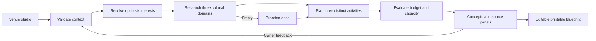

# Architecture

Third Place Lab is one strict TypeScript application using React, App Router-compatible server route handlers, Zod, Lucide, and CSS. The active native Next.js runtime emits a Node.js application. The original Sites Worker build is retained through rollback scripts. Demo mode needs no database or account; all live application research requires a shared request-budget store and the official Qloo credential. No hosted LLM is used.

`types/lab.ts` defines application contracts. `lib/qloo` separates synthetic and live providers. Only server handlers import provider selection and API credentials. The client imports planning-only blueprint helpers; these cannot reach environment secrets. No NEXT_PUBLIC secret variables exist.

POST `/api/events` streams actual observable actions as NDJSON followed by a normalized run. POST `/api/refine` validates a constrained refinement request, revises context, reruns bounded tool calls, and returns revised concepts. The browser preserves revision history within the session. A local draft survives reload; the last plan is stored as an export convenience, not automatically resumed. GET `/api/health` reports configuration, never successful authentication.

Budgets are deterministic estimates that scale with group size and are capped by the budget ceiling. Accessibility and licensing are explicit host review items, not promises of certification. Prints include evidence IDs and provenance.

Native production obtains server settings from the environment and lazily constructs a Turso/libSQL store. The rollback Worker carries trusted settings and its D1 handle through request-scoped AsyncLocalStorage. Both implement the same hosting-independent request-budget interface. Before every outgoing Qloo attempt, an atomic shared allowance reservation checks explicit UTC-day/minute limits. An approval-controlled kill switch, unavailable protection, or exhausted allowance stops research without mock substitution. The quota table stores numeric counters only; no venue or response dataset is stored server-side. Native requests use a validated canonical `APP_ORIGIN` and trust Vercel client identity only when selected by the server environment. See [native migration report](native-next-migration.md) and the historical [release protection audit](public-release-audit.md).
